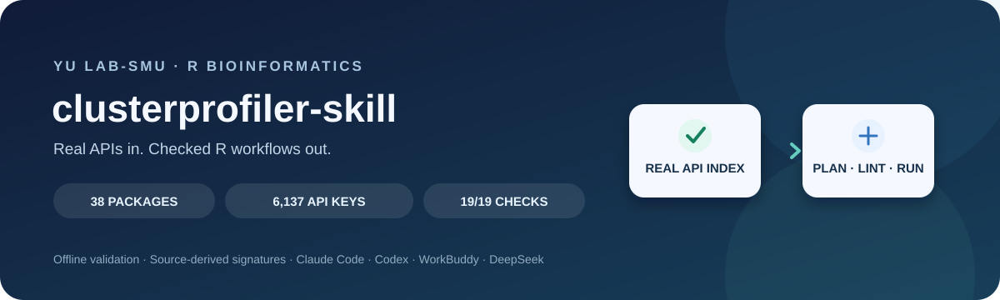

# clusterprofiler-skill · YuLab-SMU R ecosystem skill

<p align="center">
  
</p>

<p align="center">
  <a href="README.zh-CN.md">简体中文</a> · <a href="README.es.md">Español</a> · <a href="README.fr.md">Français</a> · <a href="README.ja.md">日本語</a> · <a href="README.ko.md">한국어</a>
</p>

> A cross-agent skill for writing, checking, planning, and running analyses across the YuLab-SMU R bioinformatics ecosystem.

**38 packages · 6,137 allowlist keys · offline Python tools · 19/19 self-checks passing**

This skill helps AI agents use real package APIs instead of inventing function names or arguments. Its API index is generated from upstream `NAMESPACE` and R source signatures, and `cp_lint.py` checks R scripts before delivery.

| | |
|---|---|
| Install guide | [INSTALL.md](INSTALL.md) |
| Skill instructions | [SKILL.md](SKILL.md) |
| Changelog | [CHANGELOG.md](CHANGELOG.md) |
| License and attribution | [LICENSE](LICENSE), [NOTICE](NOTICE) |

## What it does

- **Checks R scripts offline.** `cp_lint.py` catches unknown ecosystem functions, invalid arguments when signatures are known, common misspellings, syntax issues, and full-width punctuation.
- **Looks up real signatures.** `cp_api.py` searches the generated API index without network access.
- **Plans analysis workflows.** `cp_plan.py` maps a plain-language request to suggested steps and functions.
- **Covers 38 YuLab-SMU ecosystem packages.** The generated index contains 6,137 keys, including qualified `pkg::symbol` names; 3,087 have parsed formal arguments.
- **Runs the real R package.** `scripts/run_cp.R` invokes R; Python does not reimplement or fabricate analysis results.

## Quick start

```bash
# Install for Claude Code (default)
python3 install.py

# Other supported hosts
python3 install.py --host codex
python3 install.py --host workbuddy
python3 install.py --host deepseek

# Check the skill and lint an R script
python3 tools/selftest.py
python3 tools/cp_lint.py path/to/analysis.R --json
```

On Windows, use `python` if `python3` is not available. The Python tools need only the Python standard library. Running an analysis requires R and the relevant Bioconductor or CRAN packages; see [INSTALL.md](INSTALL.md).

## Verified status

The bundled self-check passes **19/19 checks**: 9 R fixtures, 44 documentation code blocks, tool smoke checks, and API-index integrity checks. Python source compilation also succeeds. R is optional and was not available in the validation environment, so actual R analyses were not executed here.

```bash
python3 tools/selftest.py
python3 -m py_compile tools/cp_api.py tools/cp_lint.py tools/cp_plan.py tools/selftest.py tools/pack.py install.py
```

## Languages

- [简体中文](README.zh-CN.md)
- [Español](README.es.md)
- [Français](README.fr.md)
- [日本語](README.ja.md)
- [한국어](README.ko.md)

## Scope and attribution

This is an independent community skill, not an official YuLab-SMU or clusterProfiler product. Its generated API facts are derived from upstream package interfaces; it does not bundle upstream implementation source. See [NOTICE](NOTICE) for details.
